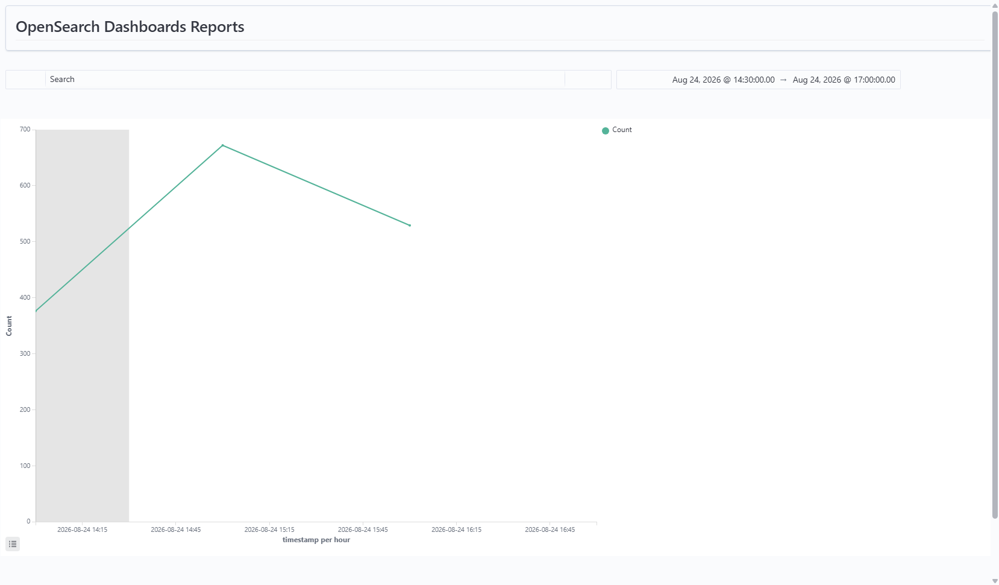

# Windows Persistence Investigation – MITRE ATT&CK T1547.001

**SOC L1 Investigation Lab using Wazuh, Sysmon and Atomic Red Team**

## 1. Overview

In this lab, I simulated and investigated a Windows persistence technique using **Atomic Red Team, Sysmon and Wazuh**.

The main goal was not only to run an attack simulation, but to understand the telemetry generated by the endpoint and investigate it as a SOC L1 analyst.

For this case, I used the MITRE ATT&CK technique:

**T1547.001 – Registry Run Keys / Startup Folder**

The Atomic Red Team test used was:

**SystemBC Malware-as-a-Service Registry**

The test creates a Registry Run Key value called:

```text
socks5_powershell
```

and configures it to execute a PowerShell command when the user logs in.

During the investigation, I analyzed:

* Process activity
* Parent-child process relationships
* PowerShell command lines
* Wazuh detection rules
* MITRE-mapped detections
* Alert activity during the investigation window

An important part of the investigation was separating the activity related to the Atomic test from other Windows activity that happened during the same period.

---

# 2. Lab Environment

The investigation was performed in an isolated virtual lab.

| Component       | Role                         |
| --------------- | ---------------------------- |
| Windows 11 VM   | Victim / endpoint            |
| Ubuntu VM       | Wazuh server                 |
| Wazuh Agent     | Sends endpoint logs to Wazuh |
| Sysmon          | Collects Windows telemetry   |
| Wazuh           | SIEM and detection platform  |
| Atomic Red Team | Attack simulation            |

### Lab architecture

```text
Atomic Red Team
       |
       v
Windows 11
       |
       +---- Sysmon
       |
       +---- Wazuh Agent
                  |
                  v
              Ubuntu
                  |
                  v
               Wazuh
                  |
                  v
          Investigation Dashboard
```

---

# 3. Investigation Objective

The main objective was to investigate the telemetry generated by the persistence simulation and understand how the activity appeared in Wazuh.

The investigation focused on these questions:

* What processes were executed?
* What was the parent-child process relationship?
* What PowerShell command was executed?
* What detections did Wazuh generate?
* Which detections were related to the Atomic test?
* Which events were unrelated background activity?
* Could I directly observe the Registry modification in the available telemetry?
* What would be the conclusion from a SOC L1 perspective?

---

# 4. MITRE ATT&CK Technique

### T1547.001 – Registry Run Keys / Startup Folder

**Tactic:** Persistence

This technique describes the use of Registry Run Keys or Startup Folders to make a program or command execute automatically when a user logs in.

For this lab, Atomic Red Team simulated this behavior by creating a value under the current user's Registry Run key.

The Registry path used by the test was:

```text
HKCU:\Software\Microsoft\Windows\CurrentVersion\Run
```

The value created by the test was:

```text
socks5_powershell
```

---

# 5. Atomic Red Team Test

The Atomic Red Team test used in this investigation was:

**T1547.001 – SystemBC Malware-as-a-Service Registry**

The main PowerShell logic used by the test was:

```powershell
$RunKey = "HKCU:\Software\Microsoft\Windows\CurrentVersion\Run"

Set-ItemProperty -Path $RunKey `
    -Name "socks5_powershell" `
    -Value "powershell.exe -windowstyle hidden -ExecutionPolicy Bypass -File"
```

### What the command does

| Element                   | Meaning                                                   |
| ------------------------- | --------------------------------------------------------- |
| `HKCU:`                   | Current user's Registry hive                              |
| `CurrentVersion\Run`      | Registry location used for logon persistence              |
| `socks5_powershell`       | Name of the Registry value                                |
| `powershell.exe`          | Program configured to run                                 |
| `-windowstyle hidden`     | Attempts to run PowerShell without showing a window       |
| `-ExecutionPolicy Bypass` | Requests bypassing the normal PowerShell execution policy |
| `-File`                   | Indicates execution of a PowerShell file/script           |

The Atomic test completed successfully with:

```text
Exit code: 0
```

This confirmed that the test itself completed successfully.

---

# 6. Windows and Wazuh Telemetry

The Windows VM had **Sysmon** installed and configured, and the Wazuh Agent was configured to send Sysmon Operational logs to the Wazuh server.

During previous lab validation, I confirmed that Wazuh was receiving Sysmon events from the Windows endpoint.

For this investigation, **Sysmon Event ID 1 – Process Creation** was especially useful because it provided information about:

* Process image
* Parent process image
* Command line
* Process GUID
* Parent Process GUID

This information allowed me to investigate the process chain instead of only looking at individual events.

---

# 7. Process Activity and Process Lineage

One of the main findings was a PowerShell parent-child relationship.

The observed relationship was:

```text
powershell.exe
      |
      v
powershell.exe
```

The relevant event contained:

```text
Image:
C:\Windows\System32\WindowsPowerShell\v1.0\powershell.exe

ParentImage:
C:\Windows\System32\WindowsPowerShell\v1.0\powershell.exe
```

The command line contained the Registry Run Key logic:

```text
"powershell.exe" & {
    $RunKey = "HKCU:\Software\Microsoft\Windows\CurrentVersion\Run"
    Set-ItemProperty -Path $RunKey
    -Name "socks5_powershell"
    -Value "powershell.exe -windowstyle hidden -ExecutionPolicy Bypass -File"
}
```

The event also contained Process GUID information:

```text
Process GUID:
{29bbc174-a443-6a8c-4903-000000001b00}

Parent Process GUID:
{29bbc174-995e-6a8c-d100-000000001b00}
```

### Why this was important

Seeing `powershell.exe` in the logs by itself would not be enough to say that it was related to the Atomic test.

The parent-child relationship and the command line gave much stronger evidence.

The combination of:

```text
PowerShell
    ↓
PowerShell
    ↓
Set-ItemProperty
    ↓
HKCU\Software\Microsoft\Windows\CurrentVersion\Run
    ↓
socks5_powershell
```

was consistent with the behavior simulated by the Atomic test.


---

# 8. Separating Related Activity from Background Activity

During the same investigation window, other processes were also visible in Wazuh.

For example:

```text
C:\Windows\System32\sdbinst.exe
```

was observed.

However, I did not include this process in the Atomic execution chain.

I compared its process information with the PowerShell events, including:

* `parentImage`
* `parentProcessGuid`
* Process GUID
* Process relationship

The information did not match the process chain created by the Atomic test.

This was important because the process occurred during the same general time period, but that does not mean it was part of the attack.

### SOC L1 reasoning

My initial hypothesis could have been:

> "This process appeared during the attack, so it may be related."

The evidence did not support that hypothesis.

The better conclusion was:

> "The process was observed during the investigation window, but its process lineage did not connect it to the Atomic execution."

This is why I treated it as background activity instead of including it in the attack chain.

### Dashboard


---

# 9. Wazuh Detection Analysis

I also reviewed the Wazuh detection rules generated during the investigation window.

One relevant detection was:

```text
PowerShell process spawned PowerShell instance
```

This detection was consistent with the PowerShell parent-child relationship observed in the Sysmon telemetry.

Other detections were also present during the same time period, including detections related to **Credential Access**.

However, I did not consider those detections part of the Atomic test because the available process and command-line evidence did not connect them to the simulated persistence activity.

This was an important part of the investigation.

I did not assume:

> "The alert appeared during the attack, therefore it belongs to the attack."

Instead, I compared the alert with the available endpoint telemetry.

---

# 10. MITRE Mapping vs. Wazuh Detections

There is an important difference between the technique simulated by Atomic Red Team and the MITRE techniques shown in Wazuh detection rules.

The Atomic test was designed to simulate:

```text
T1547.001
Registry Run Keys / Startup Folder
```

However, Wazuh may generate detections mapped to other MITRE techniques depending on the behavior observed by its rules.

For example, the investigation showed detections related to PowerShell activity and other activity that was not part of the main persistence simulation.

Therefore:

**Atomic Red Team technique ≠ every MITRE technique shown by Wazuh**

The MITRE mapping in a Wazuh rule describes the behavior that the specific detection rule is associated with. It does not automatically mean that the Atomic test performed that technique.

### Dashboard


---

# 11. Alert Timeline

I also created a timeline to visualize the number of alerts/events generated during the investigation window.

The visualization uses the event date as the time axis and the event count as the metric. I used a broader time range to include activity before, during and after the Atomic Red Team execution.

This visualization helped me get a general view of how much activity was generated during the investigation period and provided additional temporal context.

The timeline was not used by itself to determine whether an event was related to the Atomic test. I used other telemetry, such as process lineage and command-line information, to investigate the relationship between events.

### Dashboard



---

# 12. Registry Telemetry Limitation

The Atomic test attempted to create the following Registry value:

```text
HKCU:\Software\Microsoft\Windows\CurrentVersion\Run
```

with the value:

```text
socks5_powershell
```

I looked for direct Registry telemetry in the Wazuh/Sysmon data.

The available events did not provide a dedicated Registry event with enough information to directly show the creation or modification of this value.

Because of this, I did **not** claim that I directly observed the Registry modification in Wazuh.

Instead, I used the PowerShell process creation event and its command line as evidence that the `Set-ItemProperty` operation targeting the Run key was executed.

This is an important limitation of this lab and also shows why endpoint visibility is important when investigating persistence techniques.

---

# 13. Investigation Assessment

### Evidence that supports the Atomic execution

* The Atomic Red Team test completed successfully.
* Sysmon recorded PowerShell process creation.
* Wazuh received the Sysmon events.
* A PowerShell → PowerShell parent-child relationship was observed.
* Process GUID and Parent Process GUID were available for correlation.
* The command line contained the Registry Run Key modification logic.
* The command referenced `socks5_powershell`.
* Wazuh generated a PowerShell-related detection consistent with the process activity.

### Activity that was not attributed to the Atomic test

* `sdbinst.exe` was observed but its process lineage did not match the Atomic execution.
* Other background processes were not automatically considered part of the attack.
* Credential Access detections were not attributed to the persistence simulation because there was no supporting evidence connecting them to the Atomic process chain.

---

# 14. SOC L1 Conclusion

The lab successfully generated and captured telemetry related to the simulated persistence behavior.

The strongest evidence was the combination of **process lineage and command-line information**.

The investigation showed:

```text
PowerShell
    ↓
PowerShell
    ↓
Set-ItemProperty
    ↓
HKCU\Software\Microsoft\Windows\CurrentVersion\Run
    ↓
socks5_powershell
```

From a SOC L1 perspective, this behavior would be suspicious on a production endpoint if it was not part of an approved administrative action or security test.

The investigation also showed why it is important to correlate alerts with endpoint telemetry.

Not every process observed during the same period belonged to the simulated attack, and not every MITRE-mapped Wazuh detection represented the main technique being investigated.

---

# 15. Recommended SOC L1 Response

If this behavior appeared on a real endpoint without an approved testing context, I would investigate the following:

1. Identify the affected endpoint and user.
2. Validate whether the Registry Run Key modification was authorized.
3. Review the complete PowerShell process tree.
4. Review the PowerShell command line.
5. Check for other persistence mechanisms.
6. Investigate files created or executed by the PowerShell process.
7. Review network connections related to the process.
8. Search for the same Registry value across other endpoints.
9. Check whether similar PowerShell activity occurred on other systems.
10. Escalate the incident if the persistence mechanism cannot be explained by legitimate activity.

---

# 16. Lessons Learned

### Process lineage is important

A process name alone does not provide enough context.

The parent process, child process, GUIDs and command line provided much better evidence for this investigation.

### Time is not enough to prove a relationship

Two events can happen at the same time and still be unrelated.

Process relationships and other telemetry are needed to establish a stronger connection.

### Alerts need to be investigated

A detection rule is a starting point for investigation, not the final conclusion.

The analyst needs to validate whether the alert matches the actual endpoint behavior.

### MITRE mappings need context

A MITRE technique shown by a Wazuh rule does not automatically mean that it was the technique simulated by Atomic Red Team.

### Visibility has limitations

The available telemetry did not provide direct Registry modification evidence, so the investigation relied on the PowerShell command line and process telemetry.

---

# 17. Evidence

The following files are included in this project:

```text
evidence/
├── 01-process-lineage.png
├── 02-observed-processes.png
├── 03-mitre-detection-context.png
├── 04-alert-timeline.png
└── wazuh-mitre-detections.csv
```

### Dashboard screenshots

**Observed Processes**


**MITRE Detection Context**


**Alert Timeline**


---

# 18. Tools Used

| Tool            | Purpose                            |
| --------------- | ---------------------------------- |
| Wazuh           | SIEM, log collection and detection |
| Sysmon          | Windows endpoint telemetry         |
| Atomic Red Team | Controlled attack simulation       |
| Windows 11      | Lab endpoint                       |
| Ubuntu          | Wazuh server                       |

---

# 19. Disclaimer

This investigation was performed in an isolated laboratory environment for learning and defensive cybersecurity purposes.

The persistence behavior was intentionally executed using Atomic Red Team.

No unauthorized systems were targeted.
